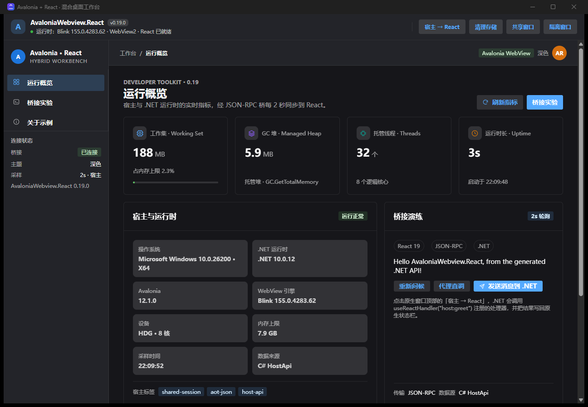
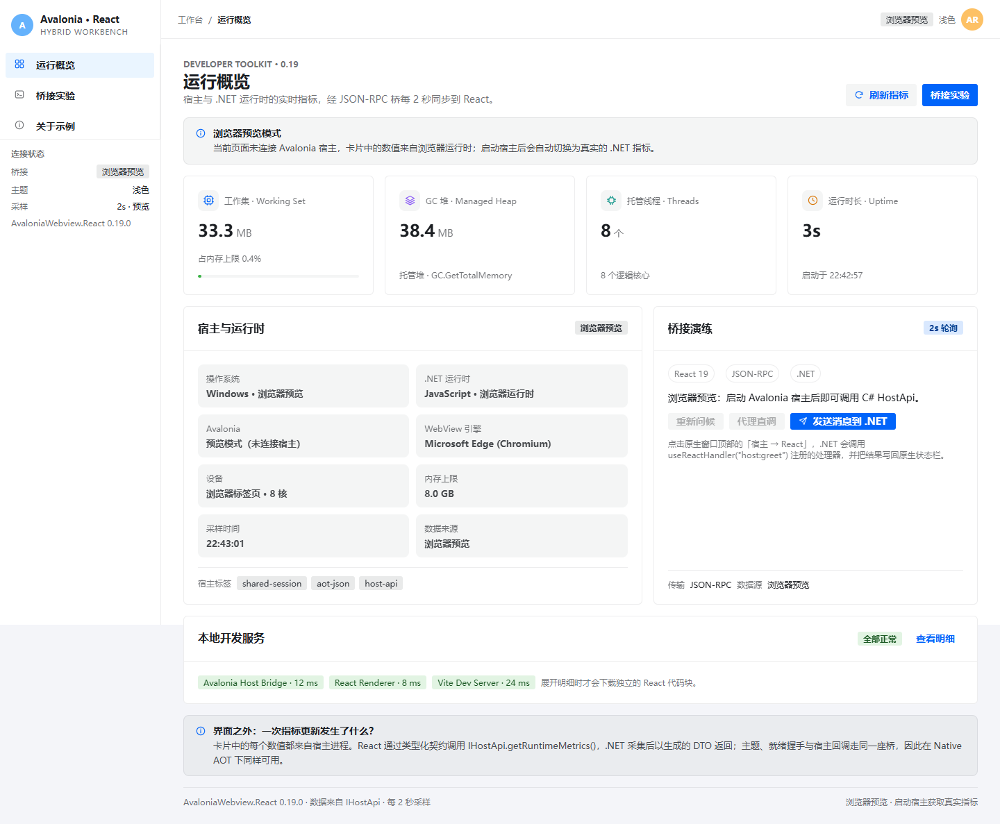
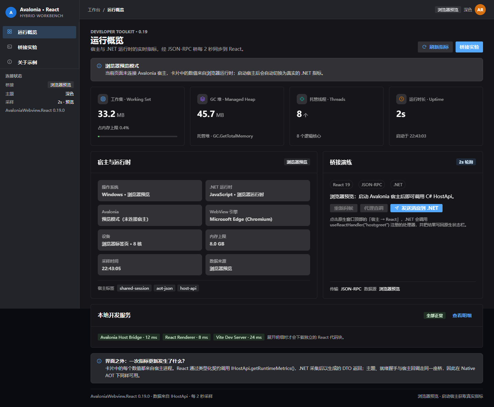
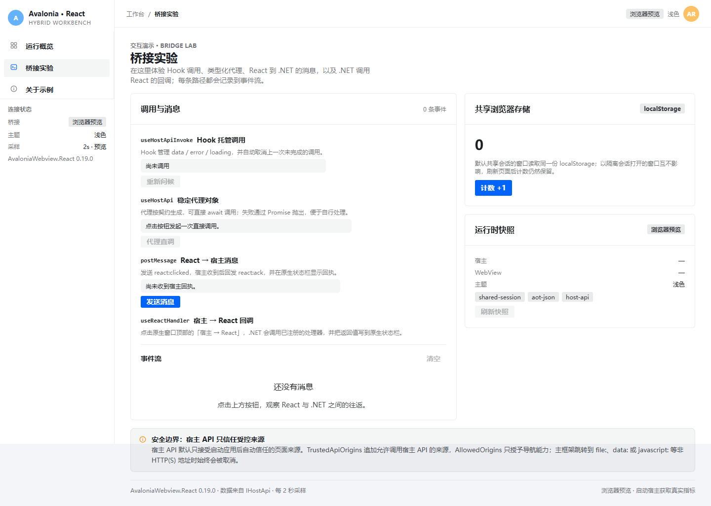

# AvaloniaWebview.React

**Host a React frontend inside Avalonia 12's official `NativeWebView` — typed host APIs, a JSON bridge, and no bundled browser engine.**

[](https://www.nuget.org/packages/AvaloniaWebview.React)
[](https://www.npmjs.com/package/@avalonia-react/bridge)


[](LICENSE)



AvaloniaWebview.React keeps the native WebView model — WebView2 on Windows, WKWebView on macOS, WebKitGTK/WPE on Linux — and adds the plumbing a hybrid desktop app needs: a typed contract generator, a request/response bridge, React hooks, theme sync, and a production asset pipeline.

## Highlights

- **Official WebView, no bundled Chromium.** Uses Avalonia 12's `NativeWebView` and the web runtime already on the machine.
- **Contract-first host APIs.** A shared `.d.ts` generates C# interfaces, DTOs, enums, and a compiler-checked TypeScript proxy.
- **Full duplex bridge.** React → .NET messages and .NET → React request/response calls with timeout and cancellation.
- **Production-ready frontend hosting.** Debug uses Vite; Release serves `wwwroot` or assets embedded in the assembly over a hardened loopback server.
- **Desktop concerns included.** Theme sync, loading overlay, navigation policy, origin-gated APIs, shared/isolated sessions, reparenting, and resource cleanup.
- **Trimming and Native AOT friendly.** Generated converters and reflection-free API dispatch ship with the source generator.
- **Agent skill included.** `skills/avalonia-webview-react-hybrid` helps coding agents work with this stack correctly.

## Quick start

### 1. Install

```sh
dotnet add package AvaloniaWebview.React
dotnet add package AvaloniaWebview.React.SourceGenerator
dotnet add package AvaloniaWebview.React.Vite   # optional Debug-time Vite startup

npm install @avalonia-react/bridge
```

Windows hosts must embed an application manifest declaring Windows 10/11 compatibility; see [getting started](docs/getting-started.md#install) and [samples/ReactHost/app.manifest](samples/ReactHost/app.manifest).

### 2. Define the contract

```ts
// @namespace MyApp.Frontend
export interface HostApi {
  getGreeting(name: string): Promise<string>;
}
```

Reference it from the .NET project:

```xml
<ItemGroup>
  <AdditionalFiles Include="..\react-app\src\FrontendApi.d.ts" />
</ItemGroup>
```

### 3. Implement and register it

```csharp
using AvaloniaWebview.React;
using MyApp.Frontend;

public sealed class HostApi : IHostApi
{
    public Task<string> GetGreetingAsync(string name) =>
        Task.FromResult($"Hello {name}");
}

HostApiBridge.Register(ReactHost.WebView, new HostApi());
```

### 4. Render the host view and call it

```xml
<react:ReactHostView x:Name="ReactHost"
                     SourceMode="Auto"
                     WaitForBridgeReady="True" />
```

```tsx
import { signalReady, createHostApiProxy } from "@avalonia-react/bridge";
import type { HostApi } from "./FrontendApi";

const hostApi = createHostApiProxy<HostApi>("HostApi");

// After React mounts.
signalReady({ frontend: "React 19" });

const greeting = await hostApi.getGreeting("Ada");
```

Deeper walkthroughs: [getting started](docs/getting-started.md) · [host integration](docs/host-integration.md) · [bridge protocol](docs/bridge.md) · [complete recipes](skills/avalonia-webview-react-hybrid/references/recipes.md).

## Screenshots

The bundled sample is a small hybrid workbench: live .NET runtime metrics, a bridge playground, and an about view, in light and dark themes.

| Light | Dark |
| --- | --- |
|  |  |



## Packages

| Package | What it does |
| --- | --- |
| `AvaloniaWebview.React` | The `AvaloniaReactWebView` control, `ReactHostView`, bridge, asset servers, sessions, diagnostics. |
| `AvaloniaWebview.React.Vite` | Optional MSBuild targets that verify or start the Vite dev server for Debug builds. |
| `AvaloniaWebview.React.SourceGenerator` | Generates C# APIs, DTOs, enums, converters, and registration helpers from `.d.ts` contracts. |
| `@avalonia-react/bridge` | ESM TypeScript client: messages, typed host API proxy, theme, errors, cancellation, React hooks. |

## Repository layout

| Path | Contents |
| --- | --- |
| `src/` | The three .NET packages and the source generator. |
| `client/` | `@avalonia-react/bridge` TypeScript package and tests. |
| `samples/ReactHost` | Avalonia desktop host used by the sample (Debug: Vite, Release: embedded assets, Native AOT profile). |
| `samples/react-app` | React 19 + Vite + Semi Design frontend for the sample. |
| `tests/` | Control, source generator, client, and native WebView end-to-end tests. |
| `skills/` | Installable Agent Skill plus API, recipe, and troubleshooting references. |
| `eng/` | Build, publish, AOT verification, and E2E helper scripts. |

## Documentation

| Guide | Contents |
| --- | --- |
| [Getting started](docs/getting-started.md) | Packages, source generator rules, React client, Agent Skill installation. |
| [Host integration](docs/host-integration.md) | Source modes, `ReactHostView`, lifecycle, navigation and security, assets, sessions, cleanup, runtime preflight, platform notes. |
| [Bridge protocol](docs/bridge.md) | React ↔ Avalonia messages, reserved events, host-to-React calls. |
| [Trimming and Native AOT](docs/trimming-and-aot.md) | Generated JSON metadata, custom serialization contexts, AOT guidance. |
| [Sample application](docs/sample.md) | What the sample demonstrates and how to run or publish it. |
| [Building and testing](docs/building-and-testing.md) | Solution build, test suites, native WebView smoke test, release flow. |
| [Changelog](CHANGELOG.md) · [Releasing](RELEASING.md) | Version history and the release process. |

## Run the sample

```sh
# Frontend (once)
cd client && npm install && npm run build
cd ../samples/react-app && npm install

# Desktop host
dotnet run --project samples/ReactHost -f net10.0-windows   # Windows
dotnet run --project samples/ReactHost -f net10.0           # macOS / Linux
```

The sample shows typed host APIs, live `getRuntimeMetrics()` data, host → React callbacks, `react:ack` round trips, shared vs. isolated sessions, lazy-loaded React modules, and Release/Native AOT packaging. See [docs/sample.md](docs/sample.md) for details, including `pwsh eng/publish-aot.ps1`.

## Platform support

| Platform | WebView engine | Runtime requirement |
| --- | --- | --- |
| Windows | WebView2 (Edge) | Installed WebView2 Evergreen runtime; Windows 10/11 compatibility manifest. |
| macOS | WKWebView (WebKit) | System WebKit; ATS `NSAllowsLocalNetworking` for HTTP loopback assets. |
| Linux | WebKitGTK or WPE WebKit | System WebKit libraries provided by the distribution. |

`AvaloniaWebview.React` targets `net10.0`; Windows hosts can reference it from `net10.0-windows`. `ReactWebViewAvailability.Check()` reports the runtime state before a window is created.

## Build and test

```sh
dotnet build AvaloniaWebview.React.slnx -c Release -p:AvaloniaReactBuildOnBuild=false -p:AvaloniaReactAutoStart=false
dotnet test tests/AvaloniaWebview.React.Tests/AvaloniaWebview.React.Tests.csproj -c Release
dotnet test tests/AvaloniaWebview.React.SourceGenerator.Tests/AvaloniaWebview.React.SourceGenerator.Tests.csproj -c Release
npm --prefix client run build
npm --prefix client test
```

The native WebView smoke test and the release workflow are documented in [docs/building-and-testing.md](docs/building-and-testing.md). GitHub Actions runs the unit suites, the WebView E2E check, and package verification on Windows and Linux.

## License

[MIT](LICENSE)
